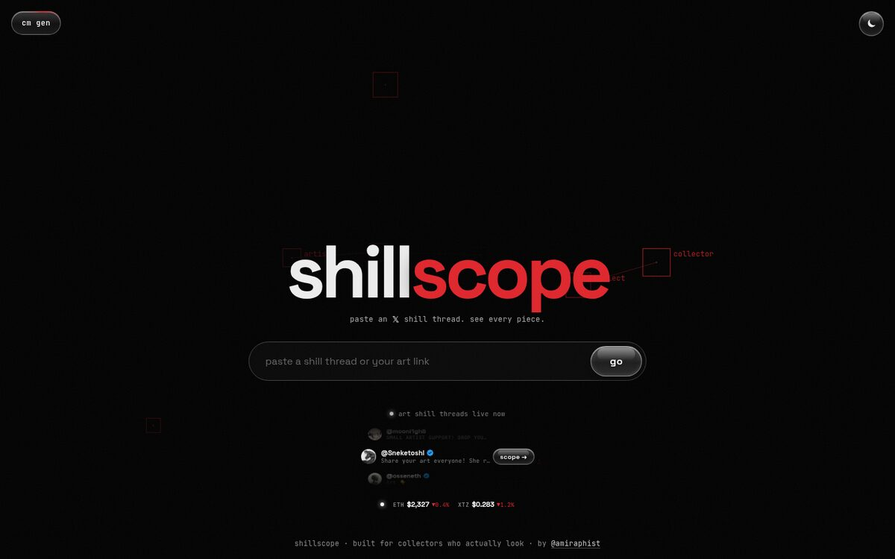
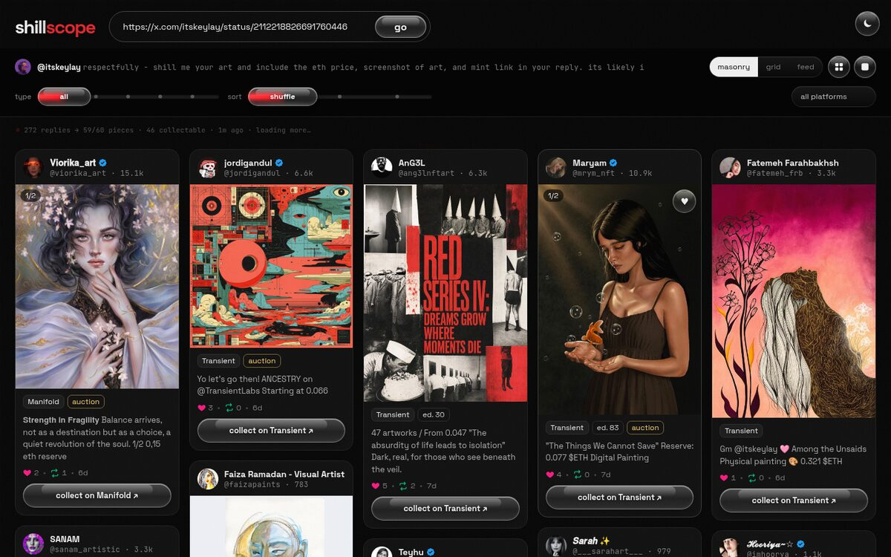
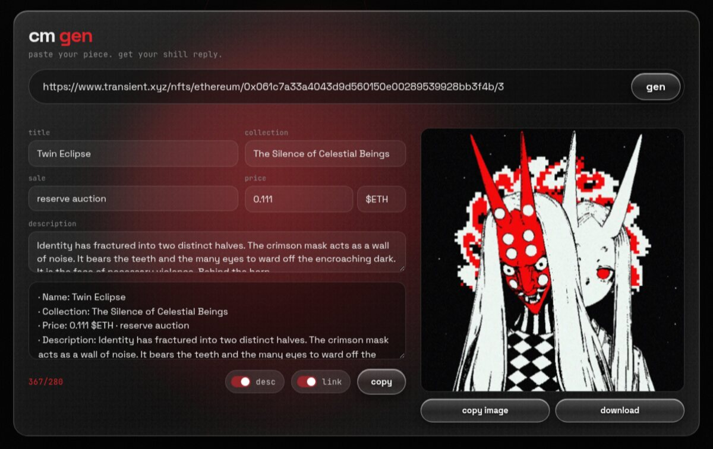

  

<h1 align="center">shillscope</h1>

<b>paste a shill thread. see every piece.</b>

  
  
  

 

collectors on x post shill threads. artists reply with their work. hundreds of replies later, the best pieces are lost in the scroll.

shillscope is the pause in that stream. every image reply becomes a card you can actually look at.

 

## how it works

**1 · copy** a collector's shill thread link on x

**2 · paste** it on [shillscope.run.place](https://shillscope.run.place)

**3 · see** every piece as a card. sort it, filter it, collect it.

 

## cm gen

for artists. paste the link to your piece and get a ready shill reply: name, collection, price, description, link and the image, one click to copy.

 

## inside

smart sort · hidden gems · sale filters · 1/1 and editions · collect list with usd total · feed mode · live hot threads · light and dark

 

© 2026 amiraphist · all rights reserved

